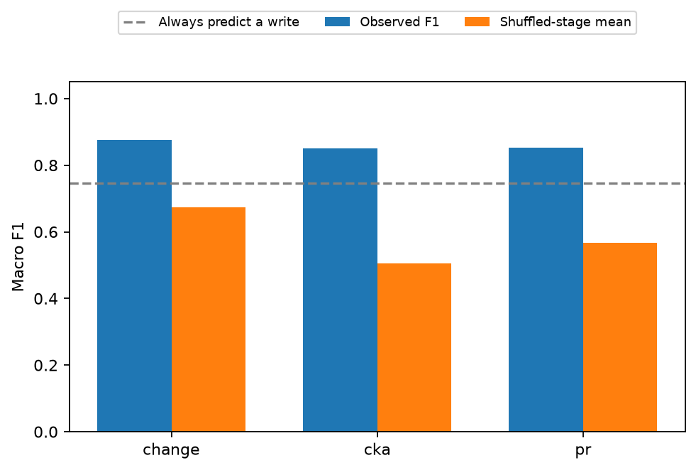
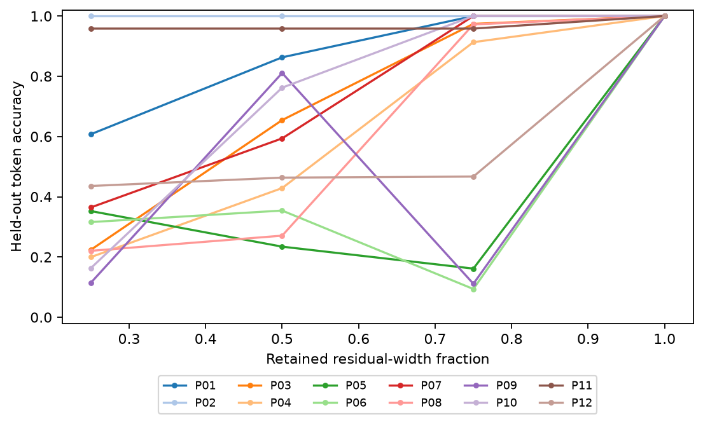
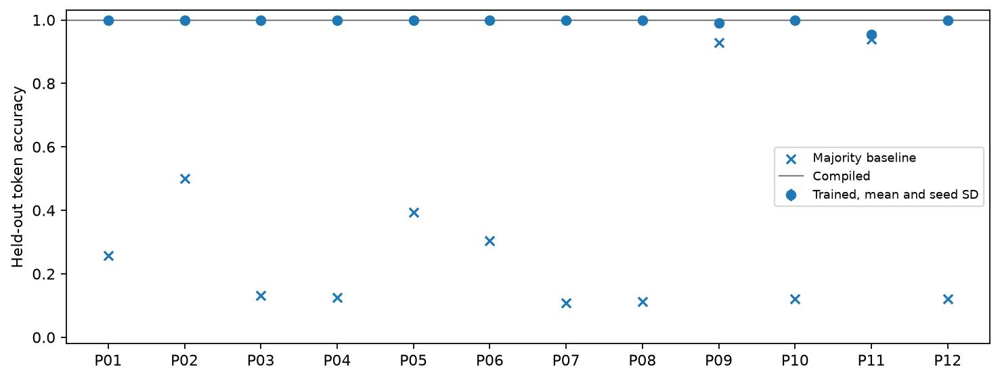
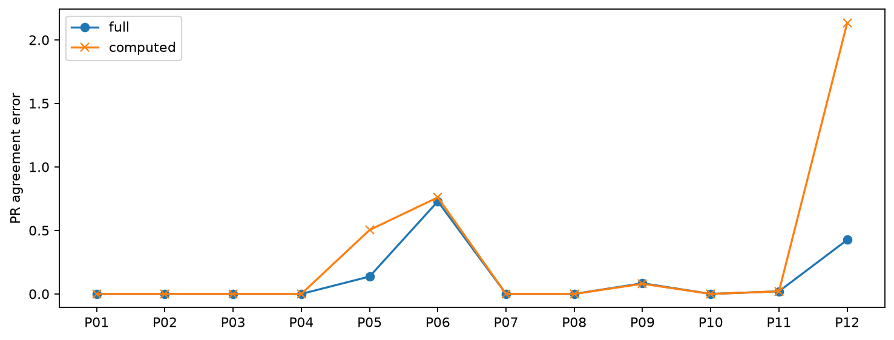

# RaspFormer research validation

This report is generated from the canonical reference runs. Completion means an experiment executed, not that its hypothesis succeeded. The original studies measure agreement with known compiled computations. The new controls separately test representation invariance, executing compression, geometry-guided interventions, blind write-transition detection, and learned transformers.

Regenerate the experiments with `.venv/bin/python -m raspformer.study`. Regenerate this report with `.venv/bin/python -m raspformer.report`.

## Variance diagnosis

The numerical policy uses total centered sample variance with ddof 1. Effective PR and component counts are zero at or below 1e-12, with an explicit inactive flag. CKA is undefined when either side is inactive. Raw variance, spectra, PR, and CKA are retained. This absolute floor is a numerical policy, not a scale-invariant definition of signal.

Matched computed-view CKA availability mismatches change from **14 to 2**. The suspicious early P07, P08, and P10 stages have variance between 8.06592e-19 and 8.06592e-19. Their raw PR is one despite negligible variation. This reproduces and resolves the normalized-score artifact at the selected floor.

Sources are [matched stages](../comparison/reference/matched/stages.csv), [floor sensitivity](../comparison/reference/matched/variance-sensitivity.csv), and [balanced sensitivity](../comparison/reference/balanced/variance-sensitivity.csv). The sensitivity tables include floors from zero through 1e-8.

| program           | stage   |   actual_total_variance |   actual_pr_raw |   actual_pr |
|:------------------|:--------|------------------------:|----------------:|------------:|
| P07_sum_with_next | L1/Attn |             8.06592e-19 |               1 |           0 |
| P07_sum_with_next | L1/MLP  |             8.06592e-19 |               1 |           0 |
| P07_sum_with_next | L2/Attn |             8.06592e-19 |               1 |           0 |
| P08_pairwise_sum  | L1/Attn |             8.06592e-19 |               1 |           0 |
| P08_pairwise_sum  | L1/MLP  |             8.06592e-19 |               1 |           0 |
| P08_pairwise_sum  | L2/Attn |             8.06592e-19 |               1 |           0 |
| P10_rotate_left   | L1/Attn |             8.06592e-19 |               1 |           0 |
| P10_rotate_left   | L1/MLP  |             8.06592e-19 |               1 |           0 |
| P10_rotate_left   | L2/Attn |             8.06592e-19 |               1 |           0 |

Remaining mismatches are retained rather than forced to agree. They occur when observed helper state already varies before the corresponding expected named-variable state.

| program                | stage   |   actual_total_variance |   expected_total_variance |
|:-----------------------|:--------|------------------------:|--------------------------:|
| P05_histogram          | L1/MLP  |                0.732809 |                  0.717984 |
| P06_count_greater_than | L1/MLP  |                0.91899  |                  0.806176 |

## Blind write-transition recovery

The detector receives ordered activation matrices only. It receives no variable names, lane labels, program graph, or write schedule. Predictions are saved and hashed before schedule extraction for scoring. Thresholds are fixed. P01 through P06 form the calibration group and P07 through P12 the held-out program group.

The three detectors use residual change energy, PR change, and adjacent CKA change. The null randomly permutes each detector's predictions within a program, preserving its predicted event count, with 1,000 draws. These results concern transitions with at least one first write. They do not recover variable names, simultaneous variable counts, or complete circuits.

| group       | detector   |   precision |   recall |       f1 |   null_mean_f1 |   all_positive_f1 |
|:------------|:-----------|------------:|---------:|---------:|---------------:|------------------:|
| calibration | change     |    0.833333 | 1        | 0.888889 |       0.551556 |          0.666667 |
| calibration | cka        |    0.916667 | 1        | 0.944444 |       0.511111 |          0.666667 |
| calibration | pr         |    0.833333 | 1        | 0.888889 |       0.556889 |          0.666667 |
| heldout     | change     |    0.77963  | 1        | 0.875992 |       0.673482 |          0.745029 |
| heldout     | cka        |    1        | 0.748016 | 0.849784 |       0.505811 |          0.745029 |
| heldout     | pr         |    0.90119  | 0.837302 | 0.85291  |       0.566622 |          0.745029 |

Per-program predictions, hashes, scores, and null permutation p-values are in [the validation reference](../validation/reference/). Macro means are descriptive over six programs per group. The all-positive baseline predicts a write at every transition, exposing high event prevalence.

Blind transition detection on held-out programs, with the count-matched shuffled-stage baseline.

In 1 held-out program-detector comparisons, F1 does not exceed the always-positive baseline. These failures remain part of the result.

| program              | detector   |       f1 |   all_positive_f1 |
|:---------------------|:-----------|---------:|------------------:|
| P11_check_palindrome | cka        | 0.727273 |          0.736842 |

## Orthogonal rotation and executing compression

| program                |   geometry_max_error |   minimum_executed_token_agreement |   import_residual_max_error |
|:-----------------------|---------------------:|-----------------------------------:|----------------------------:|
| P01_absolute           |          6.75016e-14 |                                  1 |                           0 |
| P02_index_parity       |          5.68434e-14 |                                  1 |                           0 |
| P03_increment_by_index |          7.10543e-14 |                                  1 |                           0 |
| P04_first_element      |          6.39488e-14 |                                  1 |                           0 |
| P05_histogram          |          8.34888e-14 |                                  1 |                           0 |
| P06_count_greater_than |          6.39488e-14 |                                  1 |                           0 |
| P07_sum_with_next      |          8.17124e-14 |                                  1 |                           0 |
| P08_pairwise_sum       |          1.42109e-13 |                                  1 |                           0 |
| P09_check_increasing   |          7.10543e-14 |                                  1 |                           0 |
| P10_rotate_left        |          1.19016e-13 |                                  1 |                           0 |
| P11_check_palindrome   |          1.22569e-13 |                                  1 |                           0 |
| P12_sorting            |          1.3145e-13  |                                  1 |                           0 |

Whole-space PR and linear CKA are measured before and after square orthogonal transformations. Canonical coordinate checks deliberately retain their old lane map, exposing their dependence on basis. Nonorthogonal rescaling is a separate control. Executed rotation is measured separately because finite-precision weight transformations can amplify numerical error.

Compression fits an uncentered shared basis on calibration sequences and transforms embeddings, residual input and output weights, biases, and unembedding. Forward execution carries the reduced residual width. Attention and MLP hidden widths are retained and reported, so residual reduction is not an equal reduction in total parameters. Random half-rank subspaces and full-rank controls are included.

| kind   |   fraction |   token_accuracy |   sequence_accuracy |   reconstruction_mse |   parameter_fraction |   axis_overlap_mean |
|:-------|-----------:|-----------------:|--------------------:|---------------------:|---------------------:|--------------------:|
| pca    |       0.25 |         0.41305  |           0.179688  |          0.0617453   |             0.276655 |         0.247447    |
| pca    |       0.5  |         0.616175 |           0.277778  |          0.0315115   |             0.51773  |         0.121924    |
| pca    |       0.75 |         0.72092  |           0.631076  |          0.0176273   |             0.766825 |         0.0452387   |
| pca    |       1    |         1        |           1         |          2.24355e-12 |             1        |         1.30792e-16 |
| random |       0.5  |         0.370081 |           0.0746528 |          0.0967543   |             0.51773  |         0.139267    |

Axis overlap is the mean absolute cosine between nonzero projected original coordinate directions. Full-rank orthogonal controls have zero overlap up to rounding. Reduced models have overlapping directions, making the induced coordinate mixing measurable.

Blind detectors are also rerun on the executing rotated and compressed states. The following table reports macro means for held-out programs P07 through P12, showing the PR and CKA detectors only. Their predictions are frozen before scoring against the original compiler schedule. When compression changes behavior, that schedule is an intended reference, not established ground truth for the changed computation. Task accuracy is therefore shown beside F1.

| kind               |   fraction | detector   |   token_accuracy |       f1 |   null_mean_f1 |   all_positive_f1 |
|:-------------------|-----------:|:-----------|-----------------:|---------:|---------------:|------------------:|
| compression-pca    |       0.25 | cka        |         0.376157 | 0.383333 |       0.229233 |          0.745029 |
| compression-pca    |       0.25 | pr         |         0.376157 | 0.656227 |       0.384476 |          0.745029 |
| compression-pca    |       0.5  | cka        |         0.643229 | 0.598413 |       0.364981 |          0.745029 |
| compression-pca    |       0.5  | pr         |         0.643229 | 0.84026  |       0.498002 |          0.745029 |
| compression-pca    |       0.75 | cka        |         0.751447 | 0.713492 |       0.431251 |          0.745029 |
| compression-pca    |       0.75 | pr         |         0.751447 | 0.784704 |       0.460474 |          0.745029 |
| compression-pca    |       1    | cka        |         1        | 0.849784 |       0.505811 |          0.745029 |
| compression-pca    |       1    | pr         |         1        | 0.85291  |       0.566622 |          0.745029 |
| compression-random |       0.5  | cka        |         0.376157 | 0.878884 |       0.554965 |          0.745029 |
| compression-random |       0.5  | pr         |         0.376157 | 0.852259 |       0.637456 |          0.745029 |
| rotation           |       1    | cka        |         1        | 0.849784 |       0.505811 |          0.745029 |
| rotation           |       1    | pr         |         1        | 0.85291  |       0.566622 |          0.745029 |

Accuracy of executing compressed models, using disjoint calibration and test sequences.

## Geometry-directed causal patches

Patch stages are selected from calibration geometric change and frozen before loading the compiler schedule. PCA fits calibration activations. A ridge decoder then maps the first three PCs to independently evaluated RASP variables. Decoder folds separate labels by whole sequence, but share an unsupervised PCA fitted on all calibration sequences. The final test sequences are independently held out from stage selection, PCA fitting, and decoder fitting. Donor-recipient pairs are sampled without selecting for different answers.

PCA ranks one and three are compared with equal-rank random subspaces, self patches, and a compiler-variable oracle. Counterfactual agreement is evaluated against a single mapped-variable substitution. Some symbolic substitutions can make RASP outputs undefined. Those cases remain explicit failures of that comparison rather than being dropped. Behavioral effects alone do not establish recovery of a named variable.

| kind   |   rank |   behavior_changed |   full_counterfactual_match |
|:-------|-------:|-------------------:|----------------------------:|
| oracle |      2 |          0.0208333 |                    1        |
| oracle |      6 |          0.8125    |                    1        |
| oracle |      7 |          0.5       |                    0.84375  |
| oracle |      8 |          0.8125    |                    1        |
| oracle |     13 |          0.8125    |                    1        |
| pca    |      1 |          0.0625    |                    0.520833 |
| pca    |      3 |          0.135417  |                    0.588542 |
| random |      1 |          0.015625  |                    0.463542 |
| random |      3 |          0.0572917 |                    0.421875 |
| self   |      0 |          0         |                    0.479167 |

The table includes 1152 patch conditions. Self patches are a baseline-preservation check. Per-program variable decoder results and all donor identities are saved next to the patch rows.

## Sorting row diagnosis and attention sharpening

|   attention_scale |   token_accuracy |   max_abs_lane_error |   mean_abs_lane_error |
|------------------:|-----------------:|---------------------:|----------------------:|
|                 1 |                1 |          0.000852227 |           0.000106652 |
|                 2 |                1 |          7.15256e-07 |           8.94072e-08 |
|                 4 |                1 |          1.35385e-24 |           1.07619e-25 |
|                 8 |                1 |          0           |           0           |

At the first output write, all 8 lanes have the same failing-probe set **False**. There are 512 probes failing in at least one lane. This statement comes from row-level set comparison, rather than equal percentages. Attention scales multiply actual QK logits before softmax while MLP exactness stays fixed. The sweep tests finite-attention approximation directly. It does not establish that duplicates or ties alone are the cause.

Sources are [every scalar error](../validation/reference/p12-sorting/per-observation-errors.csv), [attention sweep](../validation/reference/p12-sorting/attention-sharpening.csv), and [failing probe identities](../validation/reference/p12-sorting/failing-probe-sets.json).

## Separate depth and branch-count controls

|   requested_depth |   requested_branches |   computed_variable_count |   max_dependency_depth |   residual_width |   transformer_layers |   token_accuracy |
|------------------:|---------------------:|--------------------------:|-----------------------:|-----------------:|---------------------:|-----------------:|
|                 1 |                    1 |                         1 |                      1 |               24 |                    1 |                1 |
|                 1 |                    2 |                         3 |                      2 |               41 |                    2 |                1 |
|                 1 |                    3 |                         5 |                      3 |               57 |                    3 |                1 |
|                 2 |                    1 |                         2 |                      2 |               32 |                    2 |                1 |
|                 2 |                    2 |                         5 |                      3 |               57 |                    3 |                1 |
|                 2 |                    3 |                         8 |                      4 |               81 |                    4 |                1 |
|                 3 |                    1 |                         3 |                      3 |               40 |                    3 |                1 |
|                 3 |                    2 |                         7 |                      4 |               73 |                    4 |                1 |
|                 3 |                    3 |                        11 |                      5 |              105 |                    5 |                1 |

The centered realized depth and variable-count design matrix has rank **2**. Branch depth and branch count are crossed, and every branch contributes to the output. Serial merges also add depth, so requested branch depth is not identical to realized dependency depth. These token-local modulo programs are controlled structural examples, not a universal complexity scale. Their full schedules and geometry are preserved.

## Learned models on the same programs

| program                |   seeds |   token_accuracy |   token_std |   sequence_accuracy |   majority_token_accuracy |   compiled_token_accuracy |
|:-----------------------|--------:|-----------------:|------------:|--------------------:|--------------------------:|--------------------------:|
| P01_absolute           |       3 |         1        | 0           |            1        |                  0.256524 |                         1 |
| P02_index_parity       |       3 |         1        | 0           |            1        |                  0.5      |                         1 |
| P03_increment_by_index |       3 |         1        | 0           |            1        |                  0.130724 |                         1 |
| P04_first_element      |       3 |         1        | 0           |            1        |                  0.125554 |                         1 |
| P05_histogram          |       3 |         0.998523 | 0           |            0.998523 |                  0.394141 |                         1 |
| P06_count_greater_than |       3 |         0.998523 | 0           |            0.998523 |                  0.30453  |                         1 |
| P07_sum_with_next      |       3 |         0.999754 | 0.000246184 |            0.998523 |                  0.108813 |                         1 |
| P08_pairwise_sum       |       3 |         0.999918 | 0.000142134 |            0.999508 |                  0.111521 |                         1 |
| P09_check_increasing   |       3 |         0.989414 | 0.00390805  |            0.986706 |                  0.927622 |                         1 |
| P10_rotate_left        |       3 |         1        | 0           |            1        |                  0.121861 |                         1 |
| P11_check_palindrome   |       3 |         0.954128 | 0.00327835  |            0.944362 |                  0.939439 |                         1 |
| P12_sorting            |       3 |         1        | 0           |            1        |                  0.121861 |                         1 |

All 36 models start from random weights and train all parameters for 600 Adam steps. The shared architecture has residual width 32, two layers, and two attention heads. Whole unique sequences are split 60%, 20%, and 20% into train, validation, and test sets with split seed 2026. The source pool mixes random and structured length-six sequences over the original eight-token vocabulary. Results apply to this distribution and do not establish length generalization or behavior on natural language.

The majority-class baseline exposes class imbalance. Loss curves, exact predictions, sequence IDs, output encodings, and model checkpoints are saved. Learned-versus-compiled CKA pairs stages by relative progress across different layer counts. That is a descriptive comparison, not recovered variable correspondence. Sources are [learning summary](../learning/reference/summary.csv), [geometry](../learning/reference/geometry.csv), and [sequence splits](../learning/reference/sequence-splits.csv).

Three-seed learned-model accuracy with sequence-disjoint tests and a majority baseline.

Final-stage representation comparison, averaged over seeds, follows. Different feature spaces and unknown learned circuits prevent interpreting PR or CKA agreement as algorithm recovery.

| program                |   learned_pr |   compiled_pr |      cka |
|:-----------------------|-------------:|--------------:|---------:|
| P01_absolute           |      3.56967 |      10.6236  | 0.715386 |
| P02_index_parity       |      1.01726 |       7.32466 | 0.802356 |
| P03_increment_by_index |      1.29963 |      18.8703  | 0.362354 |
| P04_first_element      |      4.2158  |      17.7164  | 0.45823  |
| P05_histogram          |      1.13529 |      13.9161  | 0.352924 |
| P06_count_greater_than |      1.54495 |      13.3776  | 0.497534 |
| P07_sum_with_next      |      4.20361 |      19.6008  | 0.396962 |
| P08_pairwise_sum       |      4.57286 |      21.1789  | 0.355011 |
| P09_check_increasing   |      1.28516 |      17.3664  | 0.198811 |
| P10_rotate_left        |      6.15651 |      14.9264  | 0.400056 |
| P11_check_palindrome   |      2.03145 |      14.8206  | 0.152299 |
| P12_sorting            |      1.56001 |      26.8434  | 0.338914 |

## Original compiler-fidelity checks

Expected intermediate values are independently RASP-evaluated, then encoded with compiler-provided coordinates and write times. This is a fidelity benchmark. PR agreement is secondary because output cardinality, scaling, and covariance affect effective dimension.

| program                |      pr_mae |   lane_agreement |       cka_mae |   cka_paired_defined |   transitions |   cka_definition_mismatches |
|:-----------------------|------------:|-----------------:|--------------:|---------------------:|--------------:|----------------------------:|
| P01_absolute           | 0           |         1        | nan           |                    0 |             2 |                           0 |
| P02_index_parity       | 0           |         1        | nan           |                    0 |             2 |                           0 |
| P03_increment_by_index | 0           |         1        | nan           |                    0 |             2 |                           0 |
| P04_first_element      | 8.88178e-16 |         1        |   9.99201e-16 |                    1 |             2 |                           0 |
| P05_histogram          | 0.503384    |         1        | nan           |                    0 |             2 |                           1 |
| P06_count_greater_than | 0.759985    |         1        | nan           |                    0 |             2 |                           1 |
| P07_sum_with_next      | 2.82395e-07 |         1        |   4.75663e-08 |                    2 |             6 |                           0 |
| P08_pairwise_sum       | 2.22315e-07 |         1        |   5.08566e-08 |                    2 |             6 |                           0 |
| P09_check_increasing   | 0.0794928   |         1        |   0.00278887  |                    5 |             6 |                           0 |
| P10_rotate_left        | 1.33612e-07 |         1        |   3.92533e-08 |                    2 |             6 |                           0 |
| P11_check_palindrome   | 0.019994    |         1        |   0.00038537  |                    8 |            12 |                           0 |
| P12_sorting            | 2.13388     |         0.984127 |   0.0855042   |                    4 |             6 |                           0 |

Full and computed residual views on the same matched observations. Computed views retain compiler helper lanes.

## Relation to InterpBench

Gupta and colleagues' [InterpBench paper](https://papers.nips.cc/paper_files/paper/2024/hash/a8f7d43ae092d9a5295775eb17f3f4f7-Abstract-Datasets_and_Benchmarks_Track.html) trains semi-synthetic transformers with known circuits using Strict Interchange Intervention Training and evaluates circuit-discovery methods. Its [implementation](https://github.com/FlyingPumba/InterpBench) supports ACDC, subnetwork probing, and edge attribution patching. RaspFormer evaluates representation measurements and transition detection, with additional supervised learned-model comparisons. Its learned models use ordinary output supervision and do not inherit known internal causal circuits. No InterpBench model or circuit-discovery benchmark was run here.

## Evidence and limitations

Every study has a completed canonical manifest under `results/<study>/reference`. New disposable runs live under `results/<study>/runs/<UTC>-<id>`. Manifests record numerical policy, dependencies, compiler revision, source hashes, notebook source hashes, and Git state. A dirty Git state is recorded explicitly.

The new experiments do not prove universal computation recovery. Learned models lack internal ground truth. The compressed models retain attention and MLP hidden dimensions. Transition detection does not identify variable names. PCA-to-variable decoding uses supervised labels after geometry selection. No experiment establishes variable erasure or general lifetime recovery. Negative results and unavailable metrics remain in the data.
